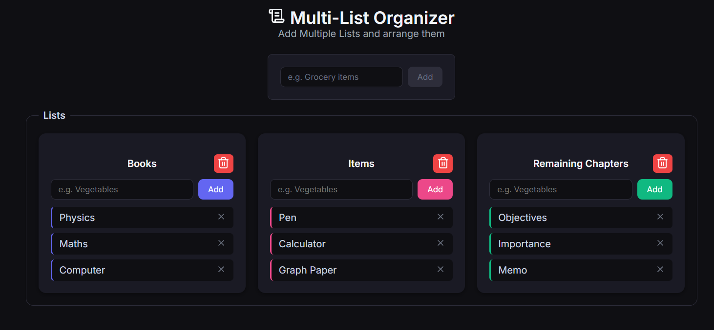

# Multi List Organizer 📋

Create multiple lists, add items to each, and keep everything organized in a dark, color-coded UI.

## Live Demo

🔗 [multi-list-organizer.vercel.app](https://multi-list-organizer.vercel.app)

---

## Preview



---

## Features

- 🗂️ Create multiple lists
- ✏️ Add items to each list independently
- 🎨 Color-coded lists with their own accent colors
- ❌ Delete lists and individual items
- 🔗 Open each list on its own page using React Router
- 🧭 Switch between lists using the sidebar
- 🌙 Dark UI with a scrollable list sidebar
- 💾 Save lists in localStorage so they stay after refreshing the page

---

## Built With

<table>
  <tr>
    <td align="center" width="80">
      
      <br><sub>React</sub>
    </td>
    <td align="center" width="80">
      
      <br><sub>Vite</sub>
    </td>
    <td align="center" width="80">
      
      <br><sub>CSS3</sub>
    </td>
    <td align="center" width="80">
      
      <br><sub>React-Router</sub>
    </td>
  </tr>
</table>

---

## Run Locally

```bash
git clone https://github.com/Aashutosh-kc/multi-list-organizer.git
cd multi-list-organizer
npm install
npm run dev
```

Built while learning React and improving my frontend skills.
